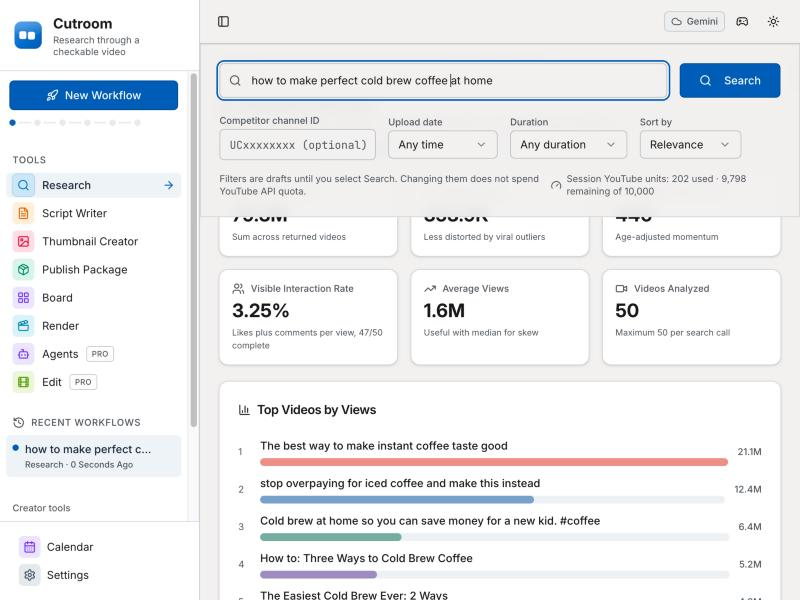
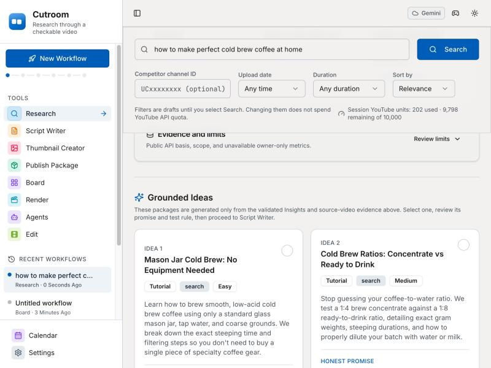
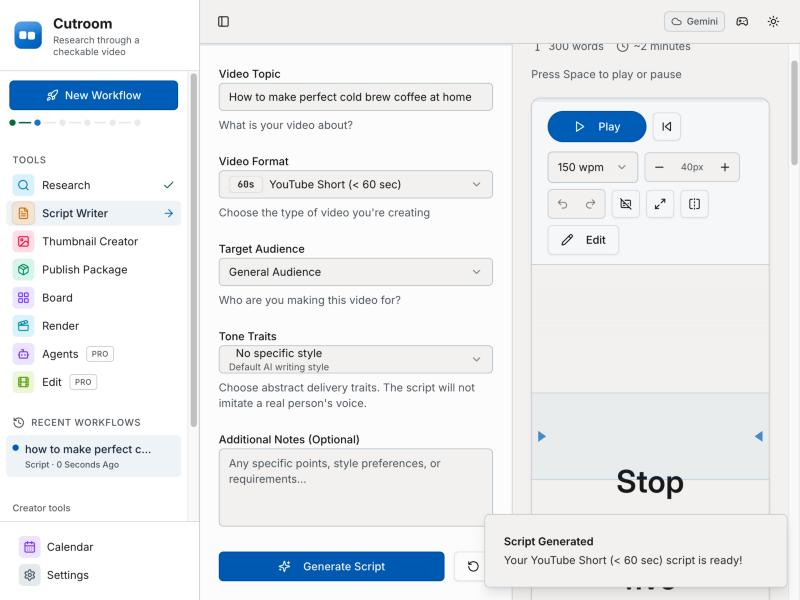
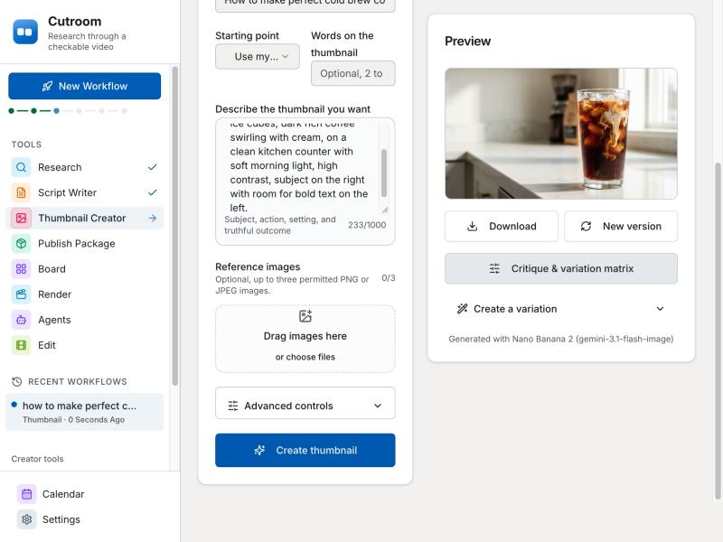
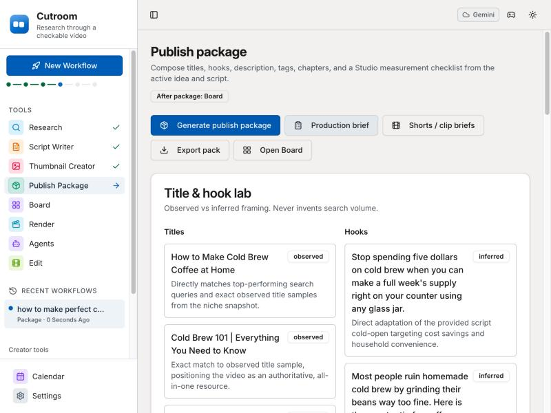
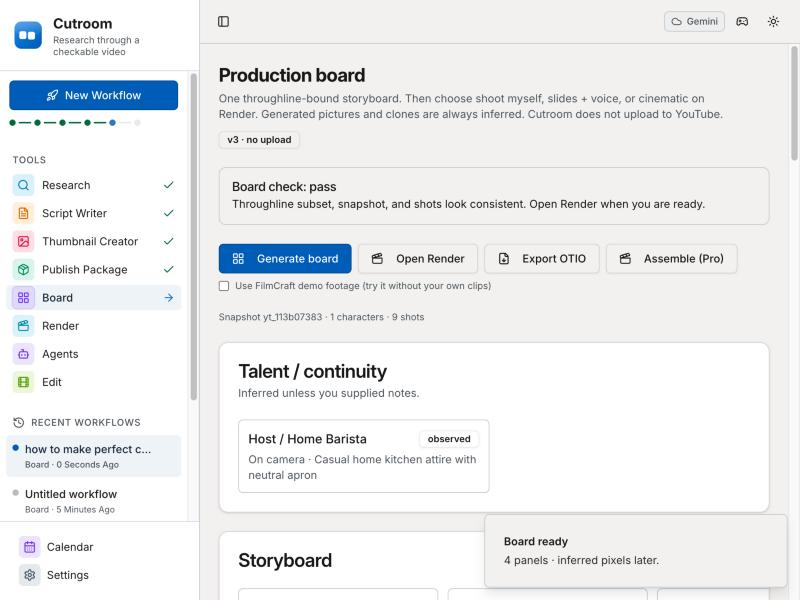
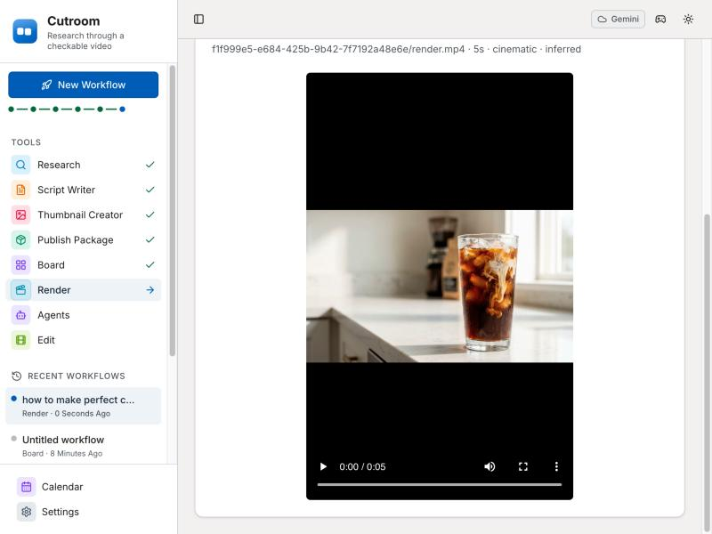

# Cutroom — Investor Demo Guide

**A 6-minute live demo that takes a bare topic to a cinematic video — with every
claim labeled by its evidence.** Screenshots below are from a real run on
2026-11-18 (topic: *"how to make perfect cold brew coffee at home"*), not mockups.

> Operator prerequisites and the exact click path: [guides/persona-walkthroughs.md](guides/persona-walkthroughs.md)
> and [guides/30-minute-demo.md](guides/30-minute-demo.md). Readiness evidence:
> [RELEASE_CHECKLIST.md](RELEASE_CHECKLIST.md).

---

## The one-liner

**Cutroom turns YouTube research into a publish-ready package and a cinematic
Short — in one local app, with every title, hook and claim traceable to evidence
or clearly marked as inferred.** Keys stay on the creator's machine. Cutroom
never uploads.

## Why it matters (the wedge)

- **Evidence-grounded, not vibes.** Every output is tagged `observed` (grounded
  in the YouTube research snapshot) or `inferred` (creative). The app *refuses to
  invent* metrics like search volume. That honesty is the product.
- **Local-first & private.** Runs as a desktop app over a loopback sidecar. No
  Cutroom account, no cloud store of the creator's keys or work.
- **Provider-agnostic.** Gemini, OpenRouter, any OpenAI-compatible gateway
  (incl. the user's own Omnirouter), local Ollama, and MiniMax for cinematic
  video — switchable in Settings, validated live (see §"Proven").
- **One room, research → video.** Competitors stop at ideas or at editing.
  Cutroom carries one throughline from research all the way to a rendered clip.

---

## The demo path (6 minutes, 7 beats)

### 1. Research — a public snapshot, with real numbers

Type a topic; Cutroom pulls a YouTube Data API snapshot and computes honest
analytics (median-aware views, interaction rate, momentum) over the sampled
videos. The quota meter is visible — nothing is hidden.

*Talking point:* 202 API units, 50 videos analyzed, 1.6M average views — live,
not canned. No invented "search volume."

### 2. Ideas — grounded in the evidence

Cutroom generates idea packages **only** from the validated insights and
source-video evidence. Each carries a promise, a test rule, and tags.

*Talking point:* "Mason Jar Cold Brew: No Equipment Needed" isn't a guess — it's
derived from the evidence claims above it.

### 3. Script — an idea-grounded teleprompter

Pick an idea; Cutroom writes a format-aware script bound to that idea's
throughline and loads it into a teleprompter.

### 4. Thumbnail — real generative image, provenance intact

A brief becomes a thumbnail via Gemini image (Nano Banana 2). Output carries
invisible SynthID provenance; no deceptive watermark is added.

### 5. Package — the honesty layer, on screen

Titles, hooks, description, tags and chapters — each tagged `observed` or
`inferred`, with the reason. "Never invents search volume" is printed in the UI.

*Talking point:* This label system is the defensible core. It's what lets a
brand or agency trust the output.

### 6. Board — a throughline-bound storyboard

One storyboard, checked against the script throughline, with talent/continuity
and a shot list. "Board check: pass" gates the render.

### 7. Cinematic video — quote-then-charge, then a real clip

Cinematic Shorts shows a **cost quote before spending** (here ~$0.45 for a 5s
MiniMax Hailuo H3 Short), then renders a real `render.mp4`. Output is labeled
inferred; Cutroom never uploads it.

*Talking point:* A finished, watchable cinematic clip for **$0.45**, with the
spend shown and confirmed up front. The whole run above cost pennies of tokens
plus that clip.

---

## Proven on 2026-11-18 (say this with confidence)

- **Full pipeline ran end-to-end on live keys** — the seven beats above produced
  real artifacts, culminating in a genuine 5.17s h264/aac MP4.
- **Four provider paths validated live:** Gemini (default, ran the pipeline),
  Omnirouter (auto-routed to `openai/gpt-6.2-astra-pro`, with usage+cost
  reported), OpenRouter, and — via Omnirouter — OpenAI models.
- **Codebase is release-clean:** `main` green — 383 tests pass, type-check and
  build clean, **0 production-dependency vulnerabilities**.

## Honest "not yet" (don't oversell)

- The **commercial layer** (accounts, Stripe/billing) is a deliberate
  positioning decision, not built — see [GTM_ROADMAP.md](GTM_ROADMAP.md).
- **Shipping installers** (notarized macOS, signed Windows), the **updater proof**,
  and the **formal paid acceptance pass** are owner-run release gates —
  [RELEASE_CHECKLIST.md](RELEASE_CHECKLIST.md) §5.
- Cutroom **does not upload to YouTube** — by design, not omission.

## The ask framing

Cutroom is a working, evidence-grounded creation desk with a defensible honesty
layer and a cinematic path already generating real clips at cents of cost. The
remaining work to "ship to strangers" is packaging and go-to-market, not core
capability.

---

🤖 Generated with [Claude Code](https://claude.com/claude-code)
