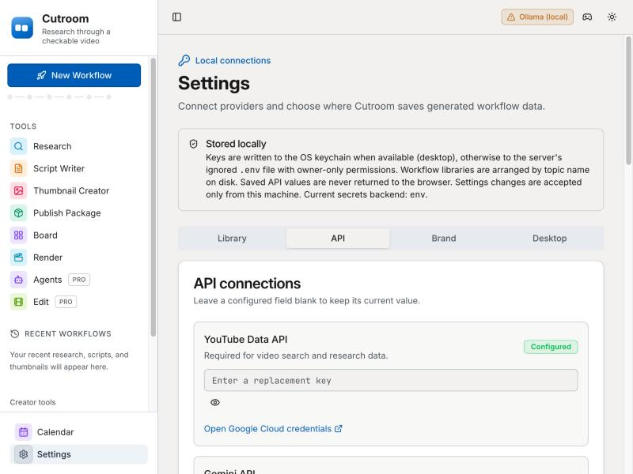
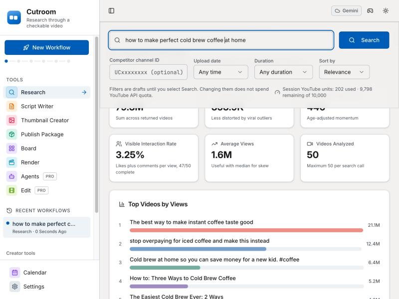
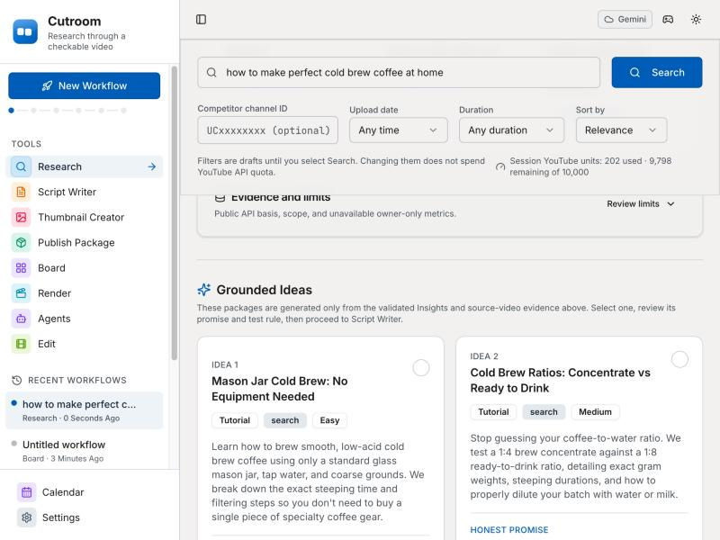
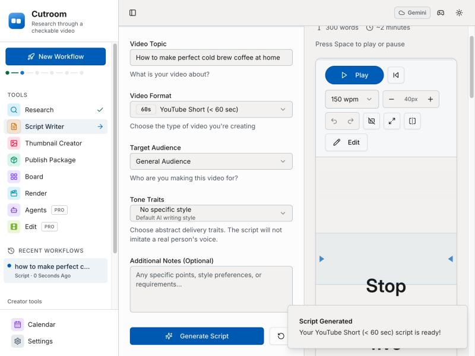
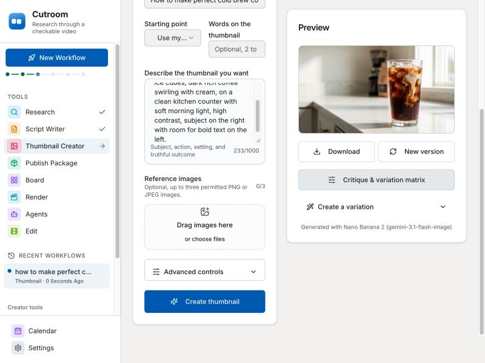
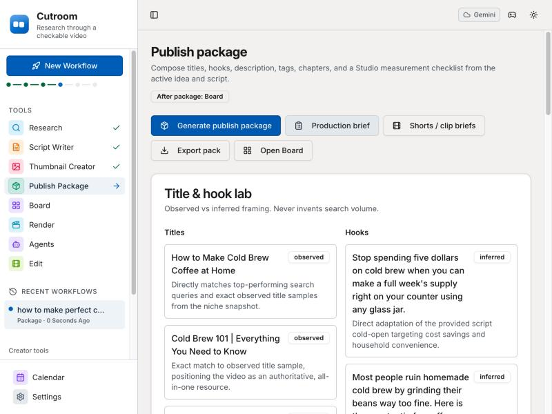
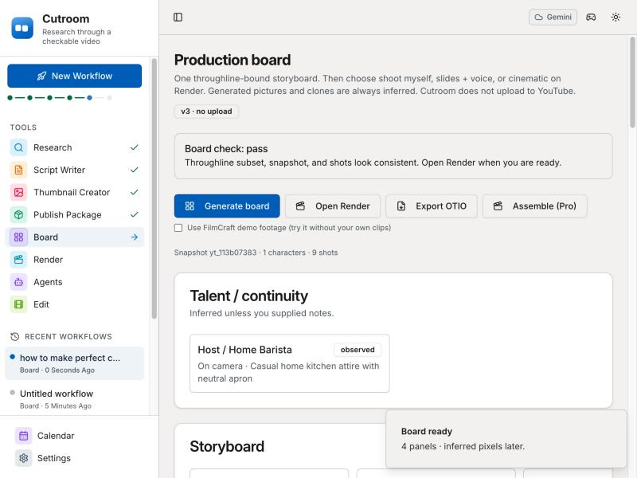
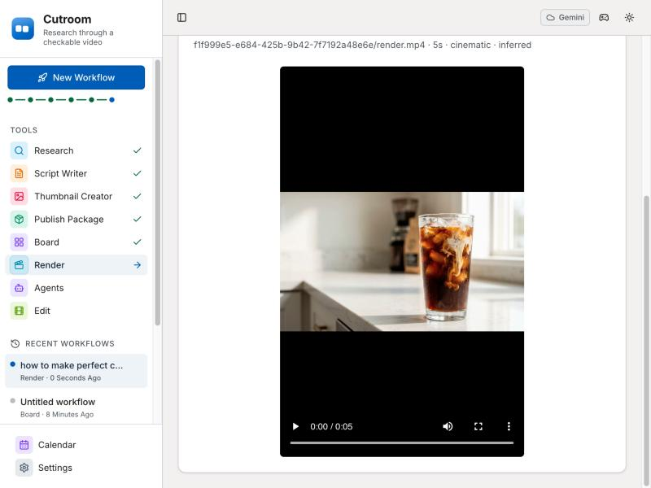

# Cutroom — Persona Walkthroughs

Task-focused walkthroughs for each kind of Cutroom user, illustrated with real
screenshots from a live run on 2026-11-18 (topic: *"how to make perfect cold brew
coffee at home"*). Personas are defined in [../personas.md](../personas.md); the
full linear walkthrough is [../USER_GUIDE.md](../USER_GUIDE.md).

**Setup once (all personas):** open **Settings → API**, add the keys you need
(YouTube is required for Research; one text provider; MiniMax for cinematic
video), and pick your text provider. Saved values are written to the OS keychain
(desktop) or the server's owner-only `.env` and are never shown again.

> Keys stay on your machine. Leave a Configured field blank to keep its current
> value. See [credentials.md](credentials.md).

---

## Persona 1 — Evidence-first solo creator

**You have:** a topic and no finished video.
**You want:** a public snapshot, an honest brief, one idea, a script, a
thumbnail, and an upload package — without inventing numbers.
**You use:** Research → Insights → Ideas → Script → Thumbnail → Package.

### 1. Research your topic
Enter the topic and Search. Cutroom pulls a YouTube snapshot and computes
median-aware analytics over the sample. Watch the quota meter — Research is the
only step that spends YouTube units.

### 2. Pick a grounded idea
Scroll to **Grounded Ideas**. Each package is derived only from the validated
insights and source videos. Select one and **Proceed to Script Writer**.

### 3. Generate the script
The Script Writer carries your selected idea. Choose a format (e.g. *YouTube
Short*), then **Generate Script**. The result loads into a teleprompter.

### 4. Make the thumbnail
In **Thumbnail Creator**, describe the shot once; Cutroom generates it with
Gemini image. Output keeps invisible SynthID provenance — no fake watermark.

### 5. Build the publish package
**Generate publish package** composes titles, hooks, description, tags and
chapters — each labeled `observed` (grounded) or `inferred` (creative). Cutroom
never invents search volume.

**You do not get:** search-volume scores, a timeline editor, or an upload button.
Keep YouTube Studio for private analytics and the upload itself.

---

## Persona 2 — Desk producer (storyboard → render)

**You have:** an idea-grounded script and package.
**You want:** a throughline-bound storyboard, then one render mode.
**You use:** Board → Render.

### 1. Generate the Board
On **Board**, generate the storyboard. It must branch from a *grounded* script
(an idea selected in Research, then a script written from it). A green **Board
check: pass** means the shots, snapshot and throughline are consistent.

### 2. Render — pick a mode
**Render** offers *Shoot myself* (filmable pack), *Slides + voice*, *Cinematic
Shorts*, and *Assemble preview*. For cinematic, Cutroom shows a **cost quote
first** (quote-then-charge). Confirm to spend (e.g. ~$0.45 for a 5s MiniMax
Hailuo H3 Short); the clip is written to `render.mp4`, labeled inferred.

**Cutroom never uploads.** Generated pixels stay labeled inferred.

---

## Persona 3 — Provider-flexible / local-model creator

**You want:** control over which model runs, including keeping text on-device.
**You use:** Settings → API → *AI text provider*.

Cutroom is provider-agnostic. The **AI text provider** dropdown selects the
active engine, and its key card appears below it:

- **Gemini** — hosted default; also powers image generation + rendering.
- **OpenAI-compatible** — any OpenAI chat-completions endpoint: OpenAI, an Azure
  gateway, or your **own Omnirouter** (set the Base URL to your gateway, e.g.
  `https://…/v1`, and a model like `auto/best-fast`).
- **OpenRouter** — routes across providers (`openrouter/auto`).
- **Ollama (local)** — runs entirely on your machine; no key, no per-token cost,
  no prompt content leaves the device. Pull the tagged model first or generation
  fails loudly rather than pretending.
- **Anthropic (Claude)** and **MiniMax** are also available; MiniMax additionally
  provides the cinematic video path.

All four hosted text paths above were validated live on 2026-11-18 (Gemini,
Omnirouter → `openai/gpt-6.2-astra-pro`, OpenRouter). Switch any time; the choice
is just the active provider — your keys stay stored and local.

---

## Persona 4 — Batch planner

**You want:** to line up several videos on this computer.
**You use:** the **Calendar** (`/calendar`) — a theme, date and status live in
the local calendar store. Each planned item starts the same Research → Package →
Board → Render flow above. No Google Calendar, no cloud sync.

---

🤖 Generated with [Claude Code](https://claude.com/claude-code)
